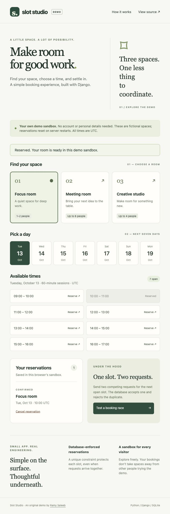

# Slot Studio

**Make room for good work.** An original Python / Django booking showcase by [Ramy Saleeb](https://github.com/RamySaleeb).

Browse three fictional workspaces, reserve an hourly slot, cancel a reservation, and send two competing requests to see double-booking prevention in action. No account or personal details required.

**[Try the live demo →](https://slot-studio-ramy.onrender.com)** · [Test workflow](https://github.com/RamySaleeb/django-booking-lab/actions/workflows/tests.yml)

Free hosting may take a moment to wake up. Demo reservations are temporary.



## Try the walkthrough

1. Choose **Focus room**, **Meeting room**, or **Creative studio**.
2. Pick one of the next seven days. Every session lasts one hour; all times are **UTC**.
3. Reserve an open time. It appears under **Your reservations** and becomes unavailable.
4. Cancel it. The slot becomes available again.
5. Click **Test a booking race**. Two real concurrent HTTP requests target the same open slot. Normally one returns `201 Created`; the other returns `409 Conflict`. Click **Check your reservations** to confirm only one booking exists. If the slot was already taken, both requests return `409`.

6. If the experiment cannot finish within **8 seconds**, it stops waiting, aborts outstanding browser requests, and offers **Check your reservations**. A request may already have created a booking even if its response was lost. Nothing is automatically retried; check the actual reservations before starting another experiment. Refreshing the page enables a new experiment using current availability.

Keyboard walkthrough: press **Tab** to reveal **Skip to booking**, then **Enter**. Use Tab/Shift+Tab and Enter to choose a room/day, reserve a time, and cancel it. Focus follows the selected link and lands on the booking/cancellation feedback after submission. During a race, focus stays on the button; after completion, Tab reaches **Check your reservations**. Text and date cards reflow on narrow screens and with enlarged text.

Each browser gets a signed, anonymous sandbox identifier. Visitors do not compete for the same global rooms, while requests within one sandbox compete for the same database slot. Booking and cancellation work without JavaScript; only the race experiment requires it.

## What this demonstrates

| Concern | Implementation |
| --- | --- |
| Double booking | Database uniqueness across sandbox, room, date, and hour; no check-then-insert race |
| Concurrent requests | Two simultaneous browser POSTs; tests also use two independent database connections |
| Business rules | Listed rooms, 09:00–17:00 hourly slots, next seven UTC days |
| Isolation | Every query and cancellation is scoped to the visitor's signed sandbox |
| Request safety | CSRF-protected POST mutations, UUID references, server-side validation |
| Accessibility | Semantic HTML, keyboard focus indicators, labelled controls, live status, responsive layout |

The view handles HTTP. `booking/services.py` owns booking rules and translates a uniqueness conflict into an expected result. `booking/models.py` owns the final database constraint. Django templates render the interface; a small JavaScript file runs the optional race.

## Run locally

Requires Python 3.14.

```sh
python -m venv .venv
source .venv/bin/activate
pip install -r requirements.txt
python manage.py migrate
python manage.py runserver
```

Open http://127.0.0.1:8000. On Windows, activate with `.venv\Scripts\activate`.

```sh
python manage.py test
python manage.py check
python manage.py makemigrations --check --dry-run
```

Race-demo tests use Node.js 22+ with no npm packages:

```sh
node --test tests/race.test.cjs
```

The 11 JavaScript tests use controlled time and fake requests to cover success, conflicts, server errors, rejection, stalled requests, late completions, cleanup, and repeat-activation guards. The 13 Django tests cover database uniqueness, competing writes, visitor isolation, cancellation ownership, slot validation, CSRF, POST-only mutations, and the server-rendered booking flow. Tests use a separate file-backed SQLite database so threaded tests exercise separate connections.

Browser regression tests (Node.js 22+ and the active Python environment):

```sh
npm ci
npx playwright install chromium
npm run test:browser
```

Seven Chromium tests cover keyboard-only booking with/without JavaScript, 320px and desktop layouts at 100%/200% text size, and race status/focus behavior. They run against local fictional data in a separate CI job. See [browser testing and manual screen-reader limitations](CONTRIBUTING.md#browser-accessibility-checks). These checks are not a WCAG certification.

## Deploy on Render

Create a **free Python web service** from this repository:

- Build: `pip install -r requirements.txt && python manage.py collectstatic --noinput`
- Start: `python manage.py migrate --noinput && gunicorn config.wsgi:application --bind 0.0.0.0:$PORT --workers 1 --threads 4`
- Set `DJANGO_DEBUG=0` and a fresh random `SECRET_KEY` (do not commit it).
- Render supplies `RENDER_EXTERNAL_HOSTNAME`, which is added to allowed hosts.
- Health endpoint: `/health/`.

This is a disposable, single-instance demo. SQLite data disappears on Render restarts or redeploys; free services may sleep when idle. It is not a real reservation system. No email, payments, customer data, public administration, or private/startup source is included.

For production, use durable PostgreSQL storage, authenticated ownership, retention/rate limits, observability, and a product-specific timezone/cancellation policy. A slot uniqueness constraint does not solve overlapping variable-duration bookings; those need a different data model. Test concurrency against the chosen production database before scaling to multiple instances.

## Contribute

See [CONTRIBUTING.md](CONTRIBUTING.md). Good next steps include PostgreSQL CI coverage, timezone display with daylight-saving tests, and manual assistive-technology checks. Please keep the demo easy to run and never commit credentials or real customer data.

## Contributor roadmap

Start with [fully booked-day and cancellation tests (#1)](https://github.com/RamySaleeb/django-booking-lab/issues/1), marked **good first issue**. Each issue includes scope, acceptance criteria, and code pointers.

| Task | Contribution level |
| --- | --- |
| [Fully booked-day tests](https://github.com/RamySaleeb/django-booking-lab/issues/1) | Small · Django tests |
| [Keyboard and large-text browser coverage](https://github.com/RamySaleeb/django-booking-lab/issues/2) | Completed · keyboard, reflow, and browser tests |
| [Race-demo deadline and partial-outcome recovery](https://github.com/RamySaleeb/django-booking-lab/issues/3) | Completed · 8-second deadline and recovery tests |
| [PostgreSQL concurrency tests in CI](https://github.com/RamySaleeb/django-booking-lab/issues/4) | Advanced · database testing |
| [Timezone and daylight-saving proposal](https://github.com/RamySaleeb/django-booking-lab/issues/5) | Design discussion · no implementation yet |

The remaining open issues welcome help. Comment on the issue before starting to coordinate work, then follow [CONTRIBUTING.md](CONTRIBUTING.md). Open items are planned improvements; completed items are marked above.

## License

MIT. All rooms and reservations are fictional. This repository is an independent portfolio demo, not a claim about a deployed customer system.

